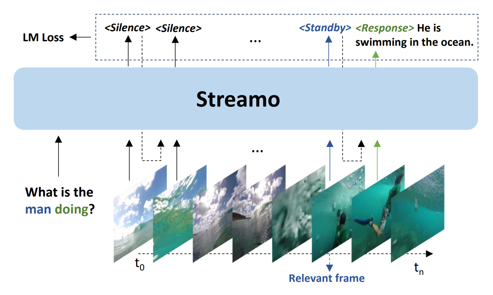

# 进度汇总

## 2026

### 9 月

------

#### 9.17

**Todo**

- [x] 找 movie + 简述 / 视频 + 简述
- [ ] 长视频怎么抽帧，找摘要
- [x] 找视频任务

------

#### 9.23

**Todo**

- [x] 看 streamo 论文
- [ ] 用现有的数据集跑 streamo 方法
- [ ] 看电影，评估解说视频质量
- [x] 开题报告：
    - 课题意义，现有研究（视频摘要 Video Summarization、流式视频 Video Streaming），国内外研究，不足之处
    - 调研 benchmark，方法（架构图）
    - 复现结果（体现自己做的工作），实验结果对比，参考文献

**Notes**

- 电影、美剧、动漫等解说视频

    - [Movies in Minutes](https://www.youtube.com/@MoviesinMinutes)

    - [Man of Recaps](https://www.youtube.com/@ManofRecaps)
- Streamo（流式视频）
    -  [Streaming Video Instruction Tuning](https://jiaerxia.github.io/Streamo/)

streamo 方法

- Slience：表示当前帧和用户提问无关，模型保持沉默，持续处理后续帧
- Standby：表示模型检测到相关视频画面，但信息尚不完整，继续收集视觉信息，等待完整事件信息
- Response：表示已经获取了足够的信息，模型输出回答

将上述方法用于生成 caption（决定什么时候输出 caption）

- Slience：表示当前输入没有产生值得描述的新语义信息，暂时不输出caption，继续读取后续帧
- Standby：已检测到一个新的事件/动作/场景变化，但事件仍在发展，信息不足以形成完整 caption，继续积累上下文
- Response：当前事件或语义变化已经足够完整，生成对应 caption

例子：比如一个视频：

​	**t₁：** 一个人站在泳池边
 		--> `<Silence>`，没有新的事件。

​	**t₂：** 他开始弯腰准备跳水
​		 --> `<Standby>`，已经检测到新动作，但还不知道最后做什么。

​	**t₃：** 他跳入水中
 		--> `<Response> A man jumps into the swimming pool.`

生成 caption：利用 LLM ，输入特定的 prompt，使模型输出增量的 caption，而不是全量的（代替之前说的使用 attention）

- prompt 示例：根据当前视频画面和历史描述，只生成相对于历史描述新增的视觉信息，不要重复历史中已经描述且当前仍然保持不变的内容。
    - 需要描述：
        1. 新出现的人物、物体或场景；
        2. 已有人物或物体的新动作；
        3. 状态发生的变化；
        4. 新产生的交互关系或事件。
    - 不需要描述：
        1. 历史中已经出现且没有发生变化的信息；
        2. 同一动作或状态的持续；
        3. 仅仅因为当前画面仍能看到某个物体而重复描述它。

---

#### 9.29

**Todo**

- [x] 定义问题（我们要做的是什么：input, output 是什么）
- [x] 整理以往长视频相关的 benchmark 有什么不足？
- [x] 我们要做的 benchmark 有什么 contribution ？

**Notes**

定义问题：我们要做的是什么？

- input：长视频/电影（1-2h）+ 字幕
- output：解说视频（视频 + 字幕 + 解说音频）（3-6 分钟）
- 片段按照原始视频顺序拼接，禁止重排
- 预算：5%，1h -> 3min；2h -> 6min

问题：视频太长了怎么处理？？？

我们要做的 benchmark 有什么 contribution：

- 视觉、文本摘要：片段时间戳 + 片段描述（已经有了）

- 完整视频的连贯文本摘要（人工 / LLM 撰写，不是拼接；能够知道人物身份，而不是全用代词指代）

  - 例如电影解说类视频：

    > 小明发现父亲留下的秘密后，前往废弃工厂寻找线索，最终在那里发现了真正的幕后凶手

    而不是：

    > 小明在房间里
    > 小明拿着纸条
    > 小明来到工厂
    > 一个男人站在那里

    这样可以评价模型是否真正理解了事件之间的关系、人物身份和故事发展

以往 benchmark 不足：

- 面向长视频摘要任务较少
- 视觉摘要和文本摘要没有很好的结合：有些数据集同时提供视觉和文本摘要，但两者是分别标注的，没有明确说明文本摘要中的内容对应原视频中的哪些画面。因此比较难研究画面和文字是否一致
- 没有完整视频对应的连贯文本摘要（比如：只是将事件描述简单的拼接）

1. WikiHow Summaries：
   - 时长：平均 1.22 分钟
   - 预算：
     - 测试集：参考摘要 ≥ 30% 原片；训练集 60%
   - 视觉摘要：步骤图片/GIF 图作为参考，在原始视频匹配对应片段，形成视觉摘要
   - 文本摘要：无
   - 不足：
     - 没有文本摘要
     - 任务是“教学步骤”，没有任务、因果和跨场景叙事
2. BLiSS：
   - 时长：每个 benchmark 样本约 5 分钟，原始直播通常数小时；628 个视频切成 13,303 个 clip
   - 预算：无
   - 视觉摘要：GIF 图作为参考，在原始视频匹配对应片段，形成视觉摘要
   - 文本摘要：人工两份
     - 从句中选 5–10 个 keyword，含 keyword 的句子作为文本摘要（标注中的 highlight）
     - 另由标注者用自己的话为整个 clip 写一段概括摘要（abstractive_summary 没找到怎么用的）
   - 不足：
     - 长视频被切成 5 分钟片段标注，回避了长程叙事
     - 没有对完整视频做摘要
     - 视觉摘要与文本摘要独立（一个是封面匹配，一个是人工选句），无法考察文字是否被画面支持
3. Mr.HiSum：
   - 时长：121-300 秒，平均 3.36 分钟
   - 预算：15 %
   - 视觉摘要：回放热度作为重要性分数，以 KTS 划分镜头，0-1 背包选择摘要片段
   - 文本摘要：无
   - 不足：
     - 没有文本摘要
     - 回放热度不代表剧情重要性
4. VideoXum：
   - 时长：10-755 秒，平均 2.07 分钟
   - 预算：15%（过滤 > 20%）
   - 视觉摘要：每条视频 10 位标注者各给一份
   - 文本摘要：原事件描述拼接而成
   - 不足：
     - 文本摘要不是重新撰写的，是事件描述拼接，不连贯
5. MMSum：
   - 时长：1.0-115.4 分钟，平均 14.5 分钟
   - 预算：无
   - 视觉摘要：收集创作者提供的分段结构（每一章的缩略图），再由 5 名专家审核
   - 文本摘要：分段文本摘要，标题式短语（OVIPAROUS, CARNIVORES 等）
   - 不足：
     - 输出是分段关键帧 + 分段标题，没有完整文本摘要
     - 章节首尾相接，不做取舍，不是做摘要
6. VISTA：
   - 时长：平均 6.76 分钟
   - 预算：无
   - 视觉摘要：无
   - 文本摘要：相应论文的 abstract（作者原文）
   - 不足：
     - 没有视觉摘要
     - 文本摘要是现成的 abstract，不保证每句话在视频中有画面依据
7. Instruct-V2Xum：
   - 时长：40-940 秒，平均 3.05 分钟
   - 预算：无
   - 视觉摘要：1 FPS 抽帧 -> LLaVA 逐帧描述 -> GPT-4V 选择 -> BERTScore 去重（得到视觉摘要） -> GPT-4 压缩改写（得到文本摘要） -> 人工筛选
   - 文本摘要：同上
   - 不足：
     - 参考答案本身由模型生成后人工筛选，评测上受模型能力限制
8. MLVU：
   - 时长：整体范围 3 分钟 - 2 小时，平均 15.5 分钟；VS 子任务只有 257 条叙事视频
   - 预算：无
   - 视觉摘要：无
   - 文本摘要：人工编写，覆盖主要内容与关键事件
   - 不足：
     - 没有视觉摘要
     - 官方“使用参考答案辅助的模型评审”打分，结论依赖 judge 可靠性
9. S-VideoXum && S-NewsVSum：
   - 时长：S-VideoXum 最长约 12.5 分钟（平均同 VideoXum，约 2 分钟）；S-NewsVSum 45 条，时长未报告
   - 预算：15%
   - 视觉摘要：沿用 VideoXum 的 10 份人工参考摘要；取分数最高的 15% 采样帧
   - 文本摘要：无；script 是输入——先有人工视觉摘要，再用 LLaVA 为每份参考摘要生成一段 script （对选出来的那批帧的描述），然后把“整段视频 + script”喂给模型，让它预测对应的帧选择
   - 不足：
     - 任务本质是“已知要讲什么，再去找画面”，与”自主决定保留哪些重要内容“是两个任务
10. SM-VideoXum && SM-MrHiSum：
    - 时长：沿用源库，平均 2-3 分钟
    - 预算：15%
    - 视觉摘要：SM-VideoXum 沿用 10 份人工参考；SM-MrHiSum 沿用回放热度构造的 1 份参考
    - 文本摘要：无；script + transcript 是输入
    - 不足：
      - 同 9，仍是 script-driven，不是自主摘要
11. MoSu：
    - 时长：主集 120-501 秒，平均 4.54 分钟；另有 50 条平均 70.4 分钟的长视频测试集
    - 预算：15%
    - 视觉摘要：回放热度作为重要性分数，以 KTS 划分镜头，0-1 背包选择摘要片段；预算 15%
    - 文本摘要：无
    - 不足：
      - 没有文本摘要
      - 回放热度不代表剧情重要性
12. LVSum：
    - 时长：72 条，10-55分钟，平均 16 分钟，13 类内容
    - 预算：15%
    - 视觉摘要：人工完整观看并回看，选关键区间，打 1-3 分；每条视频最多 10 份人工参考
    - 文本摘要：每个选中的片段配一句简短的 description
    - 不足：
      - 文本是片段级 description，不是连贯的叙事摘要
